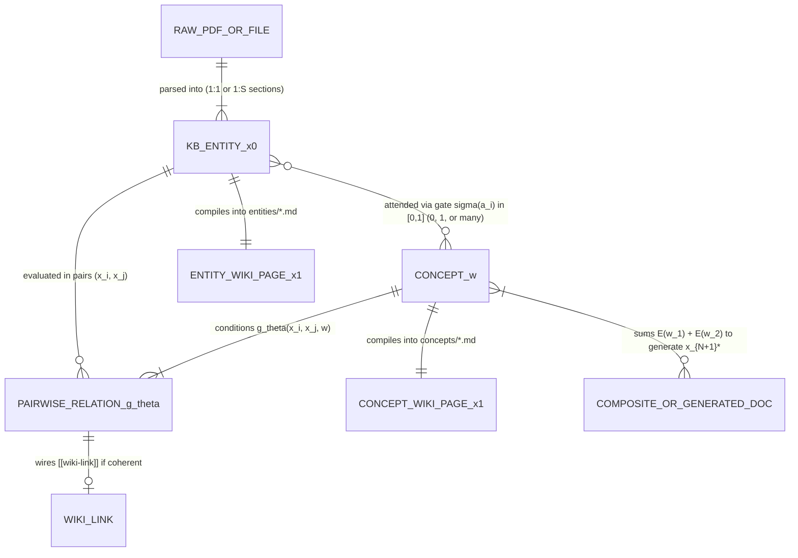
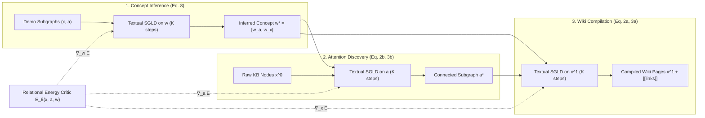

# Problem Definition & Mathematical Formulation: Energy-Based LLM Wiki via Textual Gradients

## 1. Problem Statement

Traditional Retrieval-Augmented Generation (RAG) treats a Knowledge Base (KB) as a static set of isolated text chunks retrieved via pointwise vector similarity at query time. It suffers from three core limitations:
1. **No Persistent Knowledge Compilation:** Insights and cross-document relationships are re-derived from scratch on every query rather than compounding into a structured, interlinked knowledge graph (**LLM Wiki**).
2. **Pointwise (Unary) Retrieval Blindness:** Standard top-$k$ embedding search scores each document $x_i$ independently against a query $w$ via $g(x_i, w)$, failing to capture pairwise and higher-order epistemic relations—such as whether two documents bridge two disparate fields, contradict each other, or form a closed conceptual cycle.
3. **Disconnected Operations:** Identifying relevant documents (attention/retrieval), synthesizing and cross-linking wiki pages (generation), and discovering new latent concepts from examples (clustering/induction) are typically built as separate, incompatible pipelines.

### Our Core Idea
We adapt **Concept Learning with Energy-Based Models** ([Mordatch, 2018](1811.02486v1.pdf)) to formulate an **Energy-Based LLM Wiki** where a single Relational Energy Critic $E_\theta(\mathbf{x}, \mathbf{a}, \mathbf{w})$ governs:
* **Entity Attention / Link Discovery** ($\mathbf{a}$): Selecting which KB nodes belong to a concept and should be connected.
* **Wiki Compilation & Synthesis** ($\mathbf{x}^1$): Generating and editing interlinked Markdown wiki pages (`[[wiki-links]]` + synthesis articles).
* **Concept Inference** ($\mathbf{w}$): Inducing reusable natural-language concept codes from a few example subgraphs (or discovering them unsupervised from messy KBs).

Instead of numerical backpropagation over continuous coordinates, execution-time optimization is performed via $K$**-step Textual Stochastic Gradient Langevin Dynamics (Textual SGLD)** (inspired by **ProTeGi** and **TextGrad**), where natural-language critiques act as gradients $\nabla^{\text{text}} E_\theta$.

---

## 2. Background Pillars

### 2.1 Energy-Based Concept Models (Mordatch, 2018)
* **Events** ($\mathbf{x}$): A trajectory of states $\mathbf{x} = [\mathbf{x}^0, \dots, \mathbf{x}^T]$, where $\mathbf{x}^t = [\mathbf{x}_1^t, \dots, \mathbf{x}_N^t]$ represents $N$ entities.
* **Attention Mask** ($\mathbf{a} \in \mathbb{R}^N$): Continuous mask gated via sigmoid $\sigma(\mathbf{a}_i) \in (0, 1)$ selecting which entities participate in the concept.
* **Concept Code** ($\mathbf{w} = [\mathbf{w}_x, \mathbf{w}_a]$): Latent vector specifying a concept:
  * $\mathbf{w}_a$ (*Argument concept*): Specifies the entity group the action happens over.
  * $\mathbf{w}_x$ (*Action concept*): Specifies the state transition enacted on the attended entities.
* **Boltzmann Posteriors (Eq. 1):**

$$
p(\mathbf{x} \mid \mathbf{a}, \mathbf{w}) \propto \exp\{-E_\theta(\mathbf{x}, \mathbf{a}, \mathbf{w})\}, \qquad p(\mathbf{a} \mid \mathbf{x}, \mathbf{w}) \propto \exp\{-E_\theta(\mathbf{x}, \mathbf{a}, \mathbf{w})\}
$$

* **Implicit Generation & Identification via SGLD (Eq. 2–3):**

$$
\mathbf{x}(\mathbf{a}) = \arg\min_{\mathbf{x}} E_\theta(\mathbf{x}, \mathbf{a}, \mathbf{w}), \qquad \mathbf{a}(\mathbf{x}) = \arg\min_{\mathbf{a}} E_\theta(\mathbf{x}, \mathbf{a}, \mathbf{w})
$$

approximated via $K$ steps of Stochastic Gradient Langevin Dynamics:

$$
\mathbf{x}^k = \mathbf{x}^{k-1} - \frac{\alpha}{2} \nabla_{\mathbf{x}} E_\theta(\mathbf{x}^{k-1}, \mathbf{a}, \mathbf{w}) + \omega^k, \qquad \mathbf{a}^k = \mathbf{a}^{k-1} - \frac{\alpha}{2} \nabla_{\mathbf{a}} E_\theta(\mathbf{x}, \mathbf{a}^{k-1}, \mathbf{w}) + \omega^k
$$

* **Relation Network Energy Architecture (Eq. 4):**

$$
E_\theta(\mathbf{x}, \mathbf{a}, \mathbf{w}) = f_\theta\left( \sum_{t, i, j} \sigma(\mathbf{a}_i)\sigma(\mathbf{a}_j) \cdot g_\theta(\mathbf{x}_i^t, \mathbf{x}_j^t, \mathbf{w}), \, \mathbf{w} \right)^2
$$

### 2.2 LLM Wiki Architecture (Karpathy Pattern)
* **`raw/`** ($\mathbf{x}^0$): Immutable source documents, papers, and atomic KB notes.
* **`wiki/`** ($\mathbf{x}^1$): LLM-maintained Markdown files interlinked via `[[wiki-links]]`, entity pages, synthesis concept pages, and a master `index.md` catalog.
* **Schema (`WIKI_SCHEMA.md` / **$\theta$**):** System instructions and structural invariants governing how sources are compiled and linted.

### 2.3 Textual Gradients (ProTeGi / TextGrad)
* Generalizes automatic differentiation to discrete natural-language variables $v \in \{\mathbf{a}, \mathbf{x}^1, \mathbf{w}\}$.
* The **forward pass** evaluates $E_\theta(\mathbf{x}, \mathbf{a}, \mathbf{w})$ via an LLM Critic.
* The **backward pass** produces structured natural-language edit critiques $\nabla^{\text{text}}_v E_\theta$ pointing out missing `[[wiki-links]]`, spurious entity inclusions, or unreconciled claims.
* The **update step** applies the textual critique with step size $\alpha$ (controlling edit budget per step) and Langevin exploration noise $\omega^k$.

---

## 3. Mapping Energy-Based Concept Learning to an LLM Wiki

### 3.1 Conceptual & Algorithmic Mapping (Paper → LLM Wiki + Textual Gradients)

| EBM Concept Paper ([1811.02486v1.pdf](1811.02486v1.pdf)) | Paper Equation / Section | LLM Wiki + Textual Gradient Analogue |
| :--- | :--- | :--- |
| **Entities** (`xᵢᵗ`) | Sec. 3 | Atomic KB nodes / source documents / wiki pages (containing text content, metadata, claims, tags, and outgoing `[[wiki-links]]`). |
| **Event Trajectory** (`x⁰ → x¹`) | Sec. 3 & 4 | Evolution of the KB state from initial uncompiled/raw state `x⁰` (`raw/`) to compiled/synthesized wiki state `x¹` (`wiki/`). |
| **Attention Mask** (`a ∈ ℝᴺ`) | Sec. 3, Eq. (1)–(3) | **The Subgraph / `[[wiki-links]]` Selection:** Continuous relevance gate `σ(aᵢ) ∈ (0, 1)` + textual rationale specifying which KB nodes participate in a concept or should be connected together. |
| **Concept Code** (`w = [wₓ, wₐ]`) | Sec. 4, Eq. (6) | **Natural-Language Concept Specification:** • `wₐ` (*Argument concept*): Selection criteria defining *which* entities belong to the concept. • `wₓ` (*Action/Relational concept*): How the selected entities relate, cross-link, or synthesize into a wiki article. |
| **Pairwise Relation Network** `g_θ(xᵢ, xⱼ, w)` | Sec. 3, Eq. (4) | **Pairwise Semantic Evaluation:** LLM Critic checking pairwise coherence, shared abstractions, missing `[[wiki-links]]`, or contradictions between two KB nodes `(xᵢ, xⱼ)` gated by `σ(aᵢ)σ(aⱼ)`. |
| **Energy Function** `E_θ(x, a, w) ≥ 0` | Sec. 3, Eq. (4) | **Wiki Incoherence / Violation Critic:** Evaluates how badly the current wiki pages `x`, links `a`, and concept definition `w` violate epistemic/structural criteria (`0` = fully coherent, self-contained, and properly linked; `> 0` = missing links, irrelevant nodes included, contradictions, or missing concept synthesis). |
| **Identification** `a(x) = argmin_a E_θ` | Sec. 3, Eq. (2b) | **Attention Discovery:** Discovering which KB nodes belong to concept `wₐ` and should be linked together via multi-step Textual SGLD over `a`. |
| **Generation** `x(a) = argmin_x E_θ` | Sec. 3, Eq. (2a) | **Wiki Page & Link Compilation:** Writing/updating canonical concept pages, adding bidirectional `[[wiki-links]]`, and updating `index.md` via multi-step Textual SGLD over `x¹`. |
| **Concept Inference** `w* = argmin_w E_θ` | Sec. 4, Eq. (8) | **Execution-Time Concept Induction:** Inferring reusable natural-language concept codes `[wₐ, wₓ]` from a few example KB clusters `X^demo` (or unsupervised from `x⁰`). |
| **SGLD Sampling** `x̃, ã ~ π` | Sec. 3, Eq. (3) | $K$**-Step Textual Gradient Descent:** Iterative natural-language critique (`∇_text E_θ`) and rewrite loop with step-size budget `α` and exploratory candidate sampling `ωᵏ`. |
| **Concept Composition** `E₁ + E₂` | Sec. 1 & 2 | **Additive Critique Composition:** Summing energies and concatenating textual critiques `∇_text E(·, w⁽¹⁾) ⊕ ∇_text E(·, w⁽²⁾)` to find bridge nodes and synthesize cross-concept wiki articles. |
| **Contrastive ML Objective** `L_p^ML` | Sec. 4, Eq. (5)–(7) | **Critic Discrimination Loss:** Softplus ranking loss `[E(gold) - E(sampled)]₊` ensuring the Critic `θ` scores true connected wiki subgraphs lower energy than unlinked/corrupted drafts. |
| **Sampler KL Objective** `L_π^KL` | Sec. 4 & Alg. 1 | **Critique Actionability Loss:** Penalizing residual energy `Ē(x̃(θ), ã(θ))` after `K` steps so the Critic's textual gradients `∇_text E_θ` are constructive enough to reach low-energy wikis in `K` edits. |
| **Cross-Domain Reuse of** `E_θ` | Sec. 5.4, Fig. 9 | **Cross-KB Transfer:** Reusing learned concept codes `w` and energy critics `E_θ` across different KB domains and document formats. |

### 3.2 Formal State Space Symbol Reference

| EBM Symbol | Mathematical Role in Paper | Concrete Representation in [energy_wiki.py](energy_wiki.py) |
| :--- | :--- | :--- |
| `x⁰ = [x₁⁰, ..., xₙ⁰]` | Initial state of `N` entities | `EventState.x0`: List of `KBEntity` objects (`entity_id`, `title`, `content`, `tags`). |
| `x¹ = [x₁¹, ..., xₙ¹]` | Next state of `N` entities | `EventState.x1` + `concept_page`: Compiled `KBEntity` pages with bidirectional `wiki_links` (`[[wiki-links]]`). |
| `a ∈ ℝᴺ` (`σ(a) ∈ (0, 1)ᴺ`) | Entity attention mask | `AttentionMask`: Continuous `logits` gated via `σ(aᵢ)` + textual `rationales` per entity. |
| `w = [wₐ, wₓ]` | Concept code vector | `ConceptCode`: Shared natural-language selection criteria `w_a`, synthesis criteria `w_x`, and `keywords`. |
| `θ` | Parameters of `f_θ, g_θ` | `MetaSchemaParams`: Rubric weights and critic prompt governing `RelationalWikiEnergyModel`. |

### 3.3 Ontology of Definitions & Relationships (PDFs, Papers, Sections, Concepts, Links & Wiki Pages)

#### A. Definitions of Core Objects

| Object / Term | Symbol | Definition in the System | Concrete Examples in Repo |
| :--- | :--- | :--- | :--- |
| **Raw Source File (PDF / Note / Log)** | Raw Input | An immutable source artifact dropped into `raw/` (a research paper PDF, Markdown note, lab notebook, engineering dev log, or incident postmortem). | `1811.02486v1.pdf`, `raw/mordatch_2018_ebm.md`, `raw/entangled_devlog_wiki_compiler.md` |
| **KB Entity (Document or Section Node)** | `xᵢ⁰` | The fundamental unit of state in `x⁰ = [x₁⁰, ..., xₙ⁰]`. Can represent a whole paper/note (document-level granularity) or a specific section/claim `x_{d,s}⁰` inside a long PDF. | `KBEntity(entity_id="welling_teh_2011_sgld")`, `KBEntity(entity_id="contradiction_note_mcmc_mixing")` |
| **Polysemous Trap / Clutter Node** | `x_trap⁰` | A raw KB entity that either shares surface vocabulary with a concept in an unrelated domain (homonym/false friend) or is isolated operational noise. | `trap_hvac_building_energy.md`, `trap_agronomy_soil_sampling.md`, `clutter_postgres_autovacuum.md` |
| **Concept (Latent Abstraction)** | `w⁽ᵐ⁾ = [wₐ⁽ᵐ⁾, wₓ⁽ᵐ⁾]` | A reusable, composable abstraction defined by two interchangeable natural-language codes: • **Argument Code (`wₐ`):** Criteria selecting *which* entities participate. • **Action Code (`wₓ`):** Rules specifying *how* attended entities relate and synthesize. | `concept_1_relational_energy_concept_learning`, `concept_2_energy_based_learning_and_sampling`, `concept_3_textual_gradient_optimization` |
| **Attention Mask / Gate** | `σ(aᵢ⁽ᵐ⁾) ∈ (0, 1)` | Continuous membership weight of entity `xᵢ` in concept `w⁽ᵐ⁾` (independent sigmoid per concept, **not** a mutually exclusive softmax across concepts). | `σ(aᵢ) = 0.97` (attended core member) vs. `σ(a_trap) = 0.04` (rejected distractor) |
| **Pairwise Relation** | `g_θ(xᵢ, xⱼ, w⁽ᵐ⁾)` | Critic evaluation of the interaction between two entities `(xᵢ, xⱼ)` under concept `w⁽ᵐ⁾`, scoring conceptual synergy, missing link deficit, and inter-document contradictions. | Synergy (`finn_2016_gcl ↔ ziebart_2008_maxent_irl`), Contradiction (`hinton_2002_cd ↔ lab-note-42`), Frustration (`finn_2016_gcl ↔ trap_hvac`) |
| **Compiled Entity Wiki Page** | `xᵢ¹` | The post-optimization Markdown file in `wiki_output/entities/*.md`, enriched with relational synthesis bullets and outgoing `[[wiki-links]]` to co-attended peers. | `wiki_output/entities/mordatch_2018_ebm.md` (`8` outgoing `[[wiki-links]]`) |
| **Compiled Concept Wiki Page** | `c⁽ᵐ⁾ ∈ x¹` | The canonical Markdown synthesis article in `wiki_output/concepts/*.md` that unifies all attended entities `{xᵢ : σ(aᵢ⁽ᵐ⁾) ≥ 0.5}`, reconciles contradictions, and documents rejected traps. | `wiki_output/concepts/concept_2_energy_based_learning_and_sampling.md` |
| **Composite / Bridge Concept** | `w_comp = w⁽¹⁾ + w⁽²⁾` | A higher-order concept formed by summing constituent energy functions `E_θ(x,a,w⁽¹⁾) + E_θ(x,a,w⁽²⁾)` to find intersection/bridge entities or generate new bridge documents `x_{N+1}^*`. | `concept_composite_sum.md`, `gen_bridge_boltzmann_textual_sgld.md` |
| **Wiki Link / Backlink** | `[[Title]]` | Directed or bidirectional Markdown hyperlink created in `x¹` whenever `σ(aᵢ)σ(aⱼ) > τ` and `g_θ(xᵢ, xⱼ, w)` confirms a shared mechanism. | `[[Concept Learning with Energy-Based Models]] ↔ [[Guided Cost Learning: Deep Inverse Optimal Control]]` |

#### B. Cardinality & Relational Rules Between Objects

| Source Object | Relation | Target Object | Cardinality | Explanation & Example |
| :--- | :--- | :--- | :---: | :--- |
| **Raw PDF / Document** | decomposes into | **KB Entities (`xᵢ⁰`)** | `1 : 1` or `1 : S` | A short paper/note is `1` entity `xᵢ⁰`; a long multi-topic PDF or digest can be split into `S` section/claim entities `x_{d,1}⁰ ... x_{d,S}⁰`. |
| **KB Entity (`xᵢ⁰`)** | participates in | **Concepts (`w⁽ᵐ⁾`)** | `N : M` (`0, 1, or k`) | **Many-to-Many:** • `0` concepts: Clutter/Traps (`σ(aᵢ⁽ᵐ⁾) < 0.5 ∀m`) • `1` concept: Specialized paper (`ziebart_2008_maxent_irl`) • `k ≥ 2` concepts: Bridge paper (`mordatch_2018_ebm` participates in all 3 concepts). |
| **Single Messy Entity (`xᵢ⁰`)** | contains | **Internal Topics / Noise** | `1 : K` | A single messy file (`entangled_devlog_wiki_compiler.md`) can mix irrelevant noise (Redis timeout) with a genuine concept mechanism (pairwise wiki-link gradients). |
| **Concept (`w⁽ᵐ⁾`)** | attends to | **Active Entity Subgraph (`a*`)** | `1 : K` (`K ≪ N`) | Each concept selects a sparse subset of `K` coherent entities out of `N` total KB entities via `σ(aᵢ⁽ᵐ⁾) ≥ 0.5`. |
| **Co-Attended Pair (`xᵢ, xⱼ`)** | induces | **Pairwise Relation (`g_θ`) & `[[wiki-link]]`** | `2 : 1` per concept | Every pair `(xᵢ, xⱼ)` with `σ(aᵢ)σ(aⱼ) ≥ 0.25` and low coherence deficit receives a bidirectional `[[wiki-link]]` in `x¹`. |
| **Concept Pair (`w⁽¹⁾, w⁽²⁾`)** | composes into | **Composite Concept / New Doc (`x_{N+1}^*`)** | `2+ : 1` | Summing `E(w⁽¹⁾) + E(w⁽²⁾)` either identifies existing bridge hubs (`mordatch_2018_ebm`) or synthesizes a brand-new bridge document (`gen_bridge_boltzmann_textual_sgld.md`). |

---

## 4. Relational Energy Function for Knowledge Bases

Given KB state $\mathbf{x}$, attention mask $\mathbf{a}$, and concept $\mathbf{w} = [\mathbf{w}_a, \mathbf{w}_x]$:

### Step 1: Pairwise Relational Operator $g_\theta(\mathbf{x}_i, \mathbf{x}_j, \mathbf{w})$
For every entity pair $(i, j)$ gated by $\sigma(\mathbf{a}_i)\sigma(\mathbf{a}_j)$, $g_\theta$ evaluates:
1. **Conceptual Coherence Deficit:** Do nodes $i$ and $j$ genuinely co-instantiate the mechanisms of $\mathbf{w}$, or is one of them tangential / a polysemous false friend?
2. **Link Topology Deficit (in **$\mathbf{x}^1$**):** Given that nodes $i$ and $j$ share core mechanisms under $\mathbf{w}_x$, do their compiled wiki pages contain explicit bidirectional `[[wiki-links]]` explaining the connection?

### Step 2: Global Aggregation $f_\theta(\cdot, \mathbf{w})$

$$
E_\theta(\mathbf{x}, \mathbf{a}, \mathbf{w}) = \Big( \theta_{\text{coh}} \mathcal{D}_{\text{coherence}}(\mathbf{x}, \mathbf{a}, \mathbf{w}) + \theta_{\text{cov}} \mathcal{D}_{\text{coverage}}(\mathbf{x}, \mathbf{a}, \mathbf{w}) + \theta_{\text{link}} \mathcal{D}_{\text{topology}}(\mathbf{x}^1, \mathbf{a}, \mathbf{w}_x) + \theta_{\text{syn}} \mathcal{D}_{\text{synthesis}}(\mathbf{x}^1, \mathbf{a}, \mathbf{w}_x) \Big)^2
$$

Alongside scalar energy $E_\theta \ge 0$, the evaluator emits three structured textual gradients:
* $\nabla^{\text{text}}_{\mathbf{w}} E_\theta$: Shared latent mechanisms across attended entities missing from $\mathbf{w}$.
* $\nabla^{\text{text}}_{\mathbf{a}} E_\theta$: Per-entity promotion/suppression signals and rationales.
* $\nabla^{\text{text}}_{\mathbf{x}^1} E_\theta$: Concrete wiki edit directives (`CREATE_CONCEPT_PAGE`, `UPDATE_CONCEPT_LINKS`, `RESOLVE_CONTRADICTION`, `LINK_DEFICIT: Connect [[A]] <-> [[B]]`).

---

## 5. Execution-Time Optimization & Meta-Learning

### 5.1 Execution-Time Inference of Concept Codes (Eq. 8) & Unsupervised Concept Discovery in Messy KBs

When demonstration clusters $X^{\text{demo}} = \{(\mathbf{x}, \mathbf{a})\}$ are given, concept codes are inferred via Equation (8):

$$
\mathbf{w}^*_\theta(X^{\text{demo}}) = \arg\min_{\mathbf{w}} \mathbb{E}_{(\mathbf{x}, \mathbf{a}) \sim X^{\text{demo}}} \big[ E_\theta(\mathbf{x}^1, \mathbf{a}, \mathbf{w}_x) + E_\theta(\mathbf{x}^0, \mathbf{a}, \mathbf{w}_a) \big]
$$

**Unsupervised Discovery When Concepts Are Unknown (Messy Real-World KBs):**
In realistic, messy Knowledge Bases (containing untagged research notes, entangled engineering logs, contradictory lab notes, polysemous surface-keyword traps like *HVAC thermal energy* or *soil sampling*, and ops clutter like *Postgres/Kubernetes*), **neither the concepts **$\mathbf{w}$** nor the attention masks **$\mathbf{a}$** are known in advance**. Following Page 2 of Mordatch (2018) (*"parsing experiences into an arrangement of concepts"*), we solve the joint minimization over $(\{\mathbf{w}^{(m)}\}, \{\mathbf{a}^{(m)}\})$ via **Alternating Live-LLM Textual SGLD**:

$$
\min_{\{\mathbf{w}^{(m)}, \mathbf{a}^{(m)}\}_{m=1}^M} \sum_{m=1}^M E_\theta\big(\mathbf{x}^0, \mathbf{a}^{(m)}, \mathbf{w}^{(m)}\big)
$$

1. **Step **$k=0$** (Unsupervised Seed Proposal):** An LLM scans the raw, untagged corpus $\mathbf{x}^0$ and proposes initial vague concept hypotheses $\mathbf{w}^{(m), 0}$ and surface-keyword attention logits $\mathbf{a}^{(m), 0}$.
2. **Alternating **$\mathbf{w}$**-Step** ($\nabla^{\text{text}}_{\mathbf{w}} E_\theta$): The LLM Critic inspects the currently attended documents $\{x_i : \sigma(a_i^{(m), k}) \ge 0.5\}$ vs. the rest of the KB and sharpens $\mathbf{w}^{(m), k} = [\mathbf{w}_a^{(m), k}, \mathbf{w}_x^{(m), k}]$ to capture the true underlying mathematical/algorithmic mechanism.
3. **Alternating **$\mathbf{a}$**-Step** ($\nabla^{\text{text}}_{\mathbf{a}} E_\theta$ via Pairwise $g_\theta(\mathbf{x}_i, \mathbf{x}_j, \mathbf{w})$): The LLM Critic evaluates pairwise synergy and domain coherence across candidate pairs $(x_i, x_j)$. Even when a polysemous trap document (e.g., *Smart Grid HVAC Thermal Energy*) matches surface words (`energy`, `sampling`, `partition`, `gradient`) at $k=0$, its pairwise contextual mismatch with genuine ML/math notes generates high pairwise frustration energy, driving its attention gate $\sigma(a_i^k)$ down to $< 0.09$ by $k=10$.
4. $\mathbf{x}^1$**-Step (Abstractive Wiki Compilation via **$\nabla^{\text{text}}_{\mathbf{x}^1} E_\theta$**):** Once $(\mathbf{w}^{(m), *}, \mathbf{a}^{(m), *})$ converges, the LLM Optimizer compiles the canonical concept Markdown page (`concepts/*.md`), reconciles inter-document contradictions, strips irrelevant noise from entangled dev logs, and wires bidirectional `[[wiki-links]]` across `entities/*.md`.

### 5.2 Additive Concept Composition (Section 1 & 2)
Multiple concepts $\{\mathbf{w}^{(1)}, \dots, \mathbf{w}^{(M)}\}$ are composed by summing their energies (and concatenating their textual gradients):

$$
E_{\text{comp}}(\mathbf{x}, \mathbf{a}, \{\mathbf{w}^{(m)}\}) = \sum_{m=1}^M E_\theta(\mathbf{x}, \mathbf{a}, \mathbf{w}^{(m)})
$$

### 5.3 Meta-Level Parameter Optimization (Eq. 5–9 & Algorithm 1)
To calibrate the Critic parameters/schema $\theta$, we minimize the joint meta-objective:

$$
\min_\theta \; \mathcal{L}_{p(\theta)}^{\text{ML}}\big(X^{\text{train}}, \mathbf{w}^*_\theta(X^{\text{demo}})\big) + \mathcal{L}_{\pi(\theta)}^{\text{KL}}\big(X^{\text{train}}, \mathbf{w}^*_\theta(X^{\text{demo}})\big)
$$

where:
* **Contrastive Maximum Likelihood Loss (Eq. 7 & 15):**

$$
\mathcal{L}^{\text{ML}}(\theta) = \big[ E_\theta(\mathbf{x}^1, \mathbf{a}, \mathbf{w}_x) - E_\theta(\bar{\mathbf{x}}, \mathbf{a}, \mathbf{w}_x) \big]_+ + \big[ E_\theta(\mathbf{x}^0, \mathbf{a}, \mathbf{w}_a) - E_\theta(\mathbf{x}^0, \bar{\mathbf{a}}, \mathbf{w}_a) \big]_+
$$

with $[z]_+ = \log(1 + \exp(z))$.
* **Sampler KL Loss (Eq. 8 / Algorithm 1):**

$$
\mathcal{L}^{\text{KL}}(\theta) = \bar{E}_\theta(\tilde{\mathbf{x}}(\theta), \mathbf{a}, \bar{\mathbf{w}}_x) + \bar{E}_\theta(\mathbf{x}^0, \tilde{\mathbf{a}}(\theta), \bar{\mathbf{w}}_a)
$$

ensuring the $K$-step Textual SGLD trajectory lands in low-energy wiki configurations.
