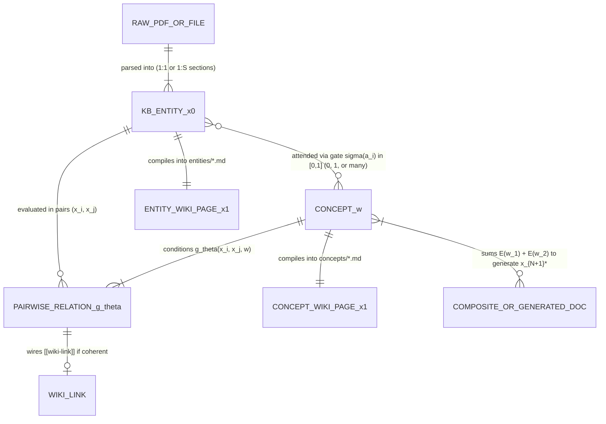

# Problem Definition & Mathematical Formulation

## 1. Problem Statement

Traditional Retrieval-Augmented Generation (RAG) treats a Knowledge Base (KB) as a static set of isolated text chunks retrieved via pointwise vector similarity at query time. It suffers from three core limitations:
1. **No Persistent Knowledge Compilation:** Insights and cross-document relationships are re-derived from scratch on every query rather than compounding into a structured, interlinked knowledge graph (**LLM Wiki**, Karpathy pattern).
2. **Pointwise (Unary) Retrieval Blindness:** Standard top-$k$ embedding search scores each document $x_i$ independently against a query $w$ via $g(x_i, w)$, failing to capture pairwise and higher-order epistemic relations—such as whether two documents bridge disparate fields, contradict each other, or share polysemous surface words in incompatible domains.
3. **Disconnected Operations:** Identifying relevant documents (attention/retrieval), synthesizing and cross-linking wiki pages (generation), and discovering new latent concepts from examples (clustering/induction) are built as separate pipelines.

**Core Thesis:** We adapt **Concept Learning with Energy-Based Models** ([Mordatch, 2018](1811.02486v1.pdf)) so that a single Relational Energy Critic $E_\theta(\mathbf{x}, \mathbf{a}, \mathbf{w})$ governs entity attention ($\mathbf{a}$), wiki compilation ($\mathbf{x}^1$), and concept discovery ($\mathbf{w}$) via **$K$-step Textual Stochastic Gradient Langevin Dynamics (Textual SGLD)** (inspired by **ProTeGi** and **TextGrad**), where natural-language critiques act as gradients $\nabla^{\text{text}} E_\theta$.

---

## 2. Original Paper Formulation (Mordatch, 2018)

In [1811.02486v1.pdf](1811.02486v1.pdf), an event is a trajectory $\mathbf{x} = [\mathbf{x}^0, \dots, \mathbf{x}^T]$ over $N$ entities $\mathbf{x}^t = [\mathbf{x}_1^t, \dots, \mathbf{x}_N^t]$, gated by an entity attention mask $\mathbf{a} \in \mathbb{R}^N$ under concept code $\mathbf{w} = [\mathbf{w}_x, \mathbf{w}_a]$.

* **Boltzmann Posteriors (Eq. 1):**

$$
p(\mathbf{x} \mid \mathbf{a}, \mathbf{w}) \propto \exp\{-E_\theta(\mathbf{x}, \mathbf{a}, \mathbf{w})\}, \qquad p(\mathbf{a} \mid \mathbf{x}, \mathbf{w}) \propto \exp\{-E_\theta(\mathbf{x}, \mathbf{a}, \mathbf{w})\}
$$

* **Implicit Generation & Identification via SGLD (Eq. 2–3):**

$$
\mathbf{x}(\mathbf{a}) = \arg\min_{\mathbf{x}} E_\theta(\mathbf{x}, \mathbf{a}, \mathbf{w}), \qquad \mathbf{a}(\mathbf{x}) = \arg\min_{\mathbf{a}} E_\theta(\mathbf{x}, \mathbf{a}, \mathbf{w})
$$

approximated via $K$ steps of Stochastic Gradient Langevin Dynamics:

$$
\mathbf{x}^k = \mathbf{x}^{k-1} - \frac{\alpha}{2} \nabla_{\mathbf{x}} E_\theta(\mathbf{x}^{k-1}, \mathbf{a}, \mathbf{w}) + \omega^k, \qquad \mathbf{a}^k = \mathbf{a}^{k-1} - \frac{\alpha}{2} \nabla_{\mathbf{a}} E_\theta(\mathbf{x}, \mathbf{a}^{k-1}, \mathbf{w}) + \omega^k
$$

* **Relation Network Energy Architecture (Eq. 4):**

$$
E_\theta(\mathbf{x}, \mathbf{a}, \mathbf{w}) = f_\theta\left( \sum_{t, i, j} \sigma(\mathbf{a}_i)\sigma(\mathbf{a}_j) \cdot g_\theta(\mathbf{x}_i^t, \mathbf{x}_j^t, \mathbf{w}), \, \mathbf{w} \right)^2
$$

---

## 3. Ontology, Definitions & Entity-Relationships

### 3.1 Definitions & Paper-to-Wiki Mapping

| Object / Concept | Math Symbol & Paper Role ([1811.02486v1.pdf](1811.02486v1.pdf)) | LLM Wiki Definition & Code Representation ([energy_wiki.py](energy_wiki.py)) | Concrete Examples in Repo |
| :--- | :--- | :--- | :--- |
| **Raw Source File** | Environment Input | An immutable artifact dropped into `raw/` (a research paper PDF, Markdown note, lab notebook, engineering dev log, or incident postmortem). | `1811.02486v1.pdf`, `raw/mordatch_2018_ebm.md`, `raw/entangled_devlog_wiki_compiler.md` |
| **KB Entity (Initial State)** | `xᵢ⁰` in `x⁰ = [x₁⁰, ..., xₙ⁰]` (Sec. 3) | `KBEntity` in `EventState.x0`: Fundamental unit of KB state. Can represent a whole paper/note or a specific section/claim `x_{d,s}⁰` inside a long PDF. | `welling_teh_2011_sgld`, `contradiction_note_mcmc_mixing` |
| **Polysemous Trap / Clutter Node** | Background / Distractor Entity | A raw KB entity that shares surface vocabulary with a concept in an unrelated domain (homonym/false friend) or is isolated operational noise. | `trap_hvac_building_energy`, `trap_agronomy_soil_sampling`, `clutter_postgres_autovacuum` |
| **Attention Mask / Gate** | `a ∈ ℝᴺ`, gate `σ(aᵢ) ∈ (0, 1)` (Eq. 1–3) | `AttentionMask`: Continuous membership weight + textual rationale per entity for a given concept (independent sigmoid per concept, not a softmax across concepts). | `σ(aᵢ) = 0.97` (attended core member) vs. `σ(a_trap) = 0.04` (rejected distractor) |
| **Concept Code** | `w = [wₐ, wₓ]` (Sec. 4, Eq. 6) | `ConceptCode`: Reusable natural-language concept specification: • **Argument Code (`wₐ`):** Selection criteria defining *which* entities belong. • **Action Code (`wₓ`):** Rules defining *how* attended entities cross-link and synthesize. | `concept_1_relational_energy_concept_learning`, `concept_2_energy_based_learning_and_sampling` |
| **Pairwise Relation Operator** | `g_θ(xᵢ, xⱼ, w)` (Sec. 3, Eq. 4) | `PairwiseRelation`: Evaluates pairs `(xᵢ, xⱼ)` gated by `σ(aᵢ)σ(aⱼ)`, scoring conceptual synergy, missing `[[wiki-link]]` deficit, and inter-document contradictions. | Synergy (`finn_2016_gcl ↔ ziebart_2008_maxent_irl`), Contradiction (`hinton_2002_cd ↔ lab-note-42`), Frustration (`finn_2016_gcl ↔ trap_hvac`) |
| **Energy Function** | `E_θ(x, a, w) ≥ 0` (Sec. 3, Eq. 4) | `RelationalWikiEnergyModel`: Global aggregation `f_θ(...)²` returning scalar energy (`0` = coherent & fully linked; `> 0` = tension/deficits) + textual gradients `∇_w E, ∇_a E, ∇_{x¹} E`. | `EnergyEvaluation` in [energy_wiki.py](energy_wiki.py) |
| **Compiled Wiki State** | `x¹ = [x₁¹, ..., xₙ¹]` (Sec. 3 & 4) | `EventState.x1` + `concept_page`: Post-optimization Markdown files in `wiki_output/` (`index.md`, `concepts/*.md`, `entities/*.md`) wired with bidirectional `[[wiki-links]]`. | `wiki_output/concepts/*.md`, `wiki_output/entities/*.md` |
| **Meta-Schema Parameters** | Network weights `θ` (Sec. 4, Eq. 9) | `MetaSchemaParams`: Critic rubric weights and domain-agnostic system prompts governing `g_θ` and `f_θ`. | `SYSTEM_CONCEPT_DISCOVERY_PROMPT`, `SYSTEM_RELATIONAL_CRITIC_PROMPT` |

### 3.2 Cardinality & Relational Rules Between Objects

| Source Object | Relation | Target Object | Cardinality | Rule & Example |
| :--- | :--- | :--- | :---: | :--- |
| **Raw PDF / File** | decomposes into | **KB Entities (`xᵢ⁰`)** | `1 : 1` or `1 : S` | A short paper/note is `1` entity `xᵢ⁰`; a long multi-topic PDF can be split into `S` section/claim entities `x_{d,1}⁰ ... x_{d,S}⁰`. |
| **KB Entity (`xᵢ⁰`)** | participates in | **Concepts (`w⁽ᵐ⁾`)** | `N : M` (`0, 1, or k`) | Many-to-many membership via independent sigmoid gates `σ(aᵢ⁽ᵐ⁾)` (detailed in Section 3.3 below). |
| **Single Messy Entity (`xᵢ⁰`)** | contains | **Internal Topics / Noise** | `1 : K` | A single file can mix irrelevant noise with a genuine concept mechanism (intra-document entanglement). |
| **Concept (`w⁽ᵐ⁾`)** | attends to | **Active Subgraph (`a*`)** | `1 : K` (`K ≪ N`) | Each concept selects a sparse subset of `K` coherent entities out of `N` total KB entities via `σ(aᵢ⁽ᵐ⁾) ≥ 0.5`. |
| **Co-Attended Pair (`xᵢ, xⱼ`)** | induces | **Pairwise `[[wiki-link]]`** | `2 : 1` per concept | Every pair `(xᵢ, xⱼ)` with `σ(aᵢ)σ(aⱼ) ≥ 0.25` and low coherence deficit receives a bidirectional `[[wiki-link]]` in `x¹`. |
| **Concept Pair (`w⁽¹⁾, w⁽²⁾`)** | composes into | **Composite / Bridge Doc (`x_{N+1}^*`)** | `2+ : 1` | Summing `E(w⁽¹⁾) + E(w⁽²⁾)` identifies existing bridge hubs or generates a brand-new bridge document `x_{N+1}^*` (see [GENERATIVE_ENERGY_SYNTHESIS.md](GENERATIVE_ENERGY_SYNTHESIS.md)). |

### 3.3 Why There Is No One-Concept-Per-Document Assumption

Because each concept $\mathbf{w}^{(m)}$ optimizes its own independent **sigmoid** attention vector $\sigma(\mathbf{a}^{(m)}) \in (0, 1)^N$ over the $N$ documents (rather than a mutually exclusive 1-of-$M$ softmax cluster assignment), a single document $x_i$ can belong to **$0$, $1$, or multiple concepts simultaneously**, and can also mix multiple unrelated topics internally:

1. **`0` Concepts (Noise / Distractors, $\sigma(a_i^{(m)}) < 0.5 \; \forall m$):**
   `clutter_postgres_autovacuum`, `clutter_k8s_ingress_tls`, and the 4 polysemous traps (`trap_hvac_building_energy`, `trap_agronomy_soil_sampling`, `trap_css_gradient_ui_bug`, `trap_hr_org_adaptation`) belong to **zero** concepts (`0` outgoing `[[wiki-links]]`).
2. **`1` Concept (Specialized Documents):**
   `ziebart_2008_maxent_irl` and `hinton_2002_cd` belong specifically to **Concept 2** (*Boltzmann Energy Learning & MCMC Sampling*), while `pryzant_2023_protegi` and `yuksekgonul_2024_textgrad` belong specifically to **Concept 3** (*Critic-Guided Textual Gradient Optimization*).
3. **`2+` Concepts Simultaneously (Multi-Concept Bridge Documents):**
   [mordatch_2018_ebm.md](experiments/exp2_messy_18docs_symbolic/wiki_output/entities/mordatch_2018_ebm.md), [finn_2017_maml.md](experiments/exp3_messy_18docs_live_llm/wiki_output/entities/finn_2017_maml.md), [grant_2017_meta_concepts.md](experiments/exp3_messy_18docs_live_llm/wiki_output/entities/grant_2017_meta_concepts.md), and [santoro_2017_relation_networks.md](experiments/exp3_messy_18docs_live_llm/wiki_output/entities/santoro_2017_relation_networks.md) each achieve high attention across **multiple concepts** simultaneously, acting as bridge hubs in the wiki graph.
4. **Intra-Document Entanglement (Multiple Topics Inside One File):**
   In [entangled_devlog_wiki_compiler.md](experiments/exp3_messy_18docs_live_llm/wiki_output/entities/entangled_devlog_wiki_compiler.md), the morning entry is about a staging Redis timeout, while the afternoon entry describes gating pairwise `LINK_DEFICIT` textual gradients by $\sigma(a_i)\sigma(a_j)$. The state compilation pass ($\nabla_{\mathbf{x}^1} E_\theta$) extracts only the afternoon textual-gradient insight into the wiki while discarding the Redis incident.

---

## 4. Knowledge Base Energy Function, Execution-Time SGLD & Meta-Losses

### 4.1 Global Energy Aggregation & Textual Gradients
Given KB state $\mathbf{x}$, attention mask $\mathbf{a}$, and concept $\mathbf{w} = [\mathbf{w}_a, \mathbf{w}_x]$:

$$
E_\theta(\mathbf{x}, \mathbf{a}, \mathbf{w}) = \Big( \theta_{\text{coh}} \mathcal{D}_{\text{coherence}}(\mathbf{x}, \mathbf{a}, \mathbf{w}) + \theta_{\text{cov}} \mathcal{D}_{\text{coverage}}(\mathbf{x}, \mathbf{a}, \mathbf{w}) + \theta_{\text{link}} \mathcal{D}_{\text{topology}}(\mathbf{x}^1, \mathbf{a}, \mathbf{w}_x) + \theta_{\text{syn}} \mathcal{D}_{\text{synthesis}}(\mathbf{x}^1, \mathbf{a}, \mathbf{w}_x) \Big)^2
$$

Differentiating $E_\theta$ in natural-language space emits three structured textual gradients:
* $\nabla^{\text{text}}_{\mathbf{w}} E_\theta$: Refines $\mathbf{w} = [\mathbf{w}_a, \mathbf{w}_x]$ to capture shared latent mechanisms across attended entities.
* $\nabla^{\text{text}}_{\mathbf{a}} E_\theta$: Per-entity promotion/suppression gradients combining unary affinity with pairwise relational synergy/frustration.
* $\nabla^{\text{text}}_{\mathbf{x}^1} E_\theta$: Discrete wiki edit directives (`CREATE_CONCEPT_PAGE`, `UPDATE_CONCEPT_LINKS`, `RESOLVE_CONTRADICTION`, `LINK_DEFICIT: Connect [[A]] <-> [[B]]`).

### 4.2 Concept Inference, Unsupervised Discovery & Additive Composition
* **From Few-Shot Demonstrations (Eq. 8):**

$$
\mathbf{w}^*_\theta(X^{\text{demo}}) = \arg\min_{\mathbf{w}} \mathbb{E}_{(\mathbf{x}, \mathbf{a}) \sim X^{\text{demo}}} \big[ E_\theta(\mathbf{x}^1, \mathbf{a}, \mathbf{w}_x) + E_\theta(\mathbf{x}^0, \mathbf{a}, \mathbf{w}_a) \big]
$$

* **Unsupervised Joint Discovery in Messy KBs (When Concepts Are Unknown):**

$$
\min_{\{\mathbf{w}^{(m)}, \mathbf{a}^{(m)}\}_{m=1}^M} \sum_{m=1}^M E_\theta\big(\mathbf{x}^0, \mathbf{a}^{(m)}, \mathbf{w}^{(m)}\big)
$$

* **Additive Concept Composition (Section 1 & 2):**

$$
E_{\text{comp}}(\mathbf{x}, \mathbf{a}, \{\mathbf{w}^{(m)}\}) = \sum_{m=1}^M E_\theta(\mathbf{x}, \mathbf{a}, \mathbf{w}^{(m)})
$$

### 4.3 Meta-Level Parameter Optimization ($\mathcal{L}_p^{\text{ML}} + \mathcal{L}_\pi^{\text{KL}}$, Eq. 5–9 & Algorithm 1)

$$
\min_\theta \; \mathcal{L}_{p(\theta)}^{\text{ML}}\big(X^{\text{train}}, \mathbf{w}^*_\theta(X^{\text{demo}})\big) + \mathcal{L}_{\pi(\theta)}^{\text{KL}}\big(X^{\text{train}}, \mathbf{w}^*_\theta(X^{\text{demo}})\big)
$$

1. **Contrastive Maximum Likelihood Loss (Eq. 7 & 15):**

$$
\mathcal{L}^{\text{ML}}(\theta) = \big[ E_\theta(\mathbf{x}^1, \mathbf{a}, \mathbf{w}_x) - E_\theta(\bar{\mathbf{x}}, \mathbf{a}, \mathbf{w}_x) \big]_+ + \big[ E_\theta(\mathbf{x}^0, \mathbf{a}, \mathbf{w}_a) - E_\theta(\mathbf{x}^0, \bar{\mathbf{a}}, \mathbf{w}_a) \big]_+
$$

with $[z]_+ = \log(1 + \exp(z))$.
2. **Sampler KL Loss (Eq. 8 / Algorithm 1):**

$$
\mathcal{L}^{\text{KL}}(\theta) = \bar{E}_\theta(\tilde{\mathbf{x}}(\theta), \mathbf{a}, \bar{\mathbf{w}}_x) + \bar{E}_\theta(\mathbf{x}^0, \tilde{\mathbf{a}}(\theta), \bar{\mathbf{w}}_a)
$$

shaping the gradient field of $E_\theta$ so $K$-step Textual SGLD trajectories converge to low-energy wiki configurations.
