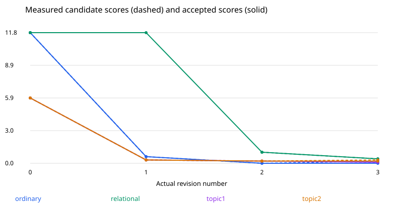

# Measured live revision pilot

> **SUPERSEDED — wrong optimization variables.** This historical run allowed concepts, memberships and text to change together. It does not test the conditional synthesis formulation and provides no evidence for or against it. Corrected Exp5 fixes concepts and masks and optimizes only the document. No corrected live run is represented here.

Solid curves are non-increasing by the acceptance rule; this is not evidence of convergence. Dashed curves include scored rejected candidates. Invalid proposals have no assigned score and appear as gaps; they consume a revision slot without a free retry. Topic-only objectives have different scales and should not be ranked against the two-topic objective.

Final deficits below come from fresh-context, arm-blinded calls with the same model. They are not independent human validation. Lower is better (0–4).

| Arm | Topic 1 | Topic 2 | Relevance | Coverage | Support | Links | Relations |
| --- | --- | --- | --- | --- | --- | --- | --- |
| ordinary | 0 | 0 | 1 | 1 | 0 | 0 | 0 |
| relational | 0 | 0 | 1 | 1 | 0 | 0 | 1 |
| topic1 | 0 | 0 | 0 | 1 | 0 | 0 | 0 |
| topic2 | 0 | 0 | 1 | 1 | 0 | 0 | 1 |

[ordinary final page](ordinary.md) · [every candidate and decision](ordinary.json)

[relational final page](relational.md) · [every candidate and decision](relational.json)

[topic1 final page](topic1.md) · [every candidate and decision](topic1.json)

[topic2 final page](topic2.md) · [every candidate and decision](topic2.json)

Equal call/output-token ceilings do not imply identical realized token consumption. See manifest and summary for usage. One constructed corpus and one run per arm cannot establish superiority or generalization.
